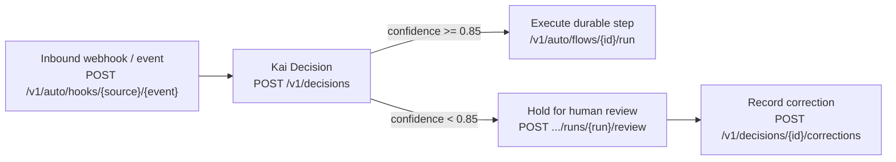

**Business Autopilot turns recurring operational processes — refund triage, invoice exceptions, lead qualification, SLA escalations — into replayable state machines.** Kai settles the bounded routing decisions; Zen drafts customer communication; durable flows guarantee retries and deduplication across crashes.

## Pattern: Event → Kai Gate → Durable Action



Notice the feedback edge: every human review automatically becomes a ground-truth correction you can feed into [`POST /v1/capabilities/{name}/train`](/docs/training/kai-capabilities).

## Create & trigger a business automation

<Tabs items={['CLI', 'SDK', 'HTTP', 'MCP']}>
<Tab value="CLI">
```bash
# 1. Create a durable automation
hanzo auto automations create --data '{
  "name": "Invoice dispute triage",
  "instructions": "Classify incoming billing dispute via Kai, draft a grounded response with Zen 6, and hold refunds above $250 for finance review.",
  "model": "enso-auto",
  "permissions": "ask"
}'

# 2. List durable flows and trigger a run
hanzo auto flows list
hanzo auto automations run "$AUTO_ID"
```
</Tab>
<Tab value="SDK">
<Tabs items={['TypeScript', 'Python']}>
<Tab value="TypeScript">
```ts
import { Configuration, AutoApi } from 'hanzoai';

const auto = new AutoApi(new Configuration({ accessToken: process.env.HANZO_API_KEY }));
const { data: created } = await auto.postAutoAutomations({
  name: 'Invoice dispute triage',
  instructions:
    'Classify incoming billing dispute via Kai, draft a grounded response with Zen 6, and hold refunds above $250 for finance review.',
  model: 'enso-auto',
  permissions: 'ask',
});
const { data: run } = await auto.postAutoAutomationsByIdRun(created.id);
console.log({ created, run });
```
</Tab>
<Tab value="Python">
```python
import os
from hanzoai.cloud import ApiClient, Configuration
from hanzoai.cloud.api import AutoApi

api = AutoApi(ApiClient(Configuration(access_token=os.environ["HANZO_API_KEY"])))
created = api.post_auto_automations({
    "name": "Invoice dispute triage",
    "instructions": "Classify incoming billing dispute via Kai, draft a grounded response with Zen 6, and hold refunds above $250 for finance review.",
    "model": "enso-auto",
    "permissions": "ask",
})
print(api.post_auto_automations_by_id_run(created["id"]))
```
</Tab>
</Tabs>
</Tab>
<Tab value="HTTP">
```bash
AUTO_ID=$(curl -s -X POST https://api.hanzo.ai/v1/auto/automations \
  -H "Authorization: Bearer $HANZO_API_KEY" \
  -H "Content-Type: application/json" \
  -d '{
    "name": "Invoice dispute triage",
    "instructions": "Classify incoming billing dispute via Kai, draft a grounded response with Zen 6, and hold refunds above $250 for finance review.",
    "model": "enso-auto",
    "permissions": "ask"
  }' | jq -r '.id')

curl -s -X POST "https://api.hanzo.ai/v1/auto/automations/${AUTO_ID}/run" \
  -H "Authorization: Bearer $HANZO_API_KEY" | jq '.'

curl -s "https://api.hanzo.ai/v1/auto/automations/${AUTO_ID}/runs" \
  -H "Authorization: Bearer $HANZO_API_KEY" | jq '.'
```
</Tab>
<Tab value="MCP">
```bash
curl -X POST https://api.hanzo.ai/v1/mcp \
  -H "Authorization: Bearer $HANZO_API_KEY" \
  -H "Content-Type: application/json" \
  -d '{
    "jsonrpc": "2.0",
    "id": 1,
    "method": "tools/call",
    "params": {
      "name": "auto",
      "arguments": {"op": "get_auto_flows", "input": {}}
    }
  }'
```
</Tab>
</Tabs>

## Durable flow versioning & resume

- Inspect flow versions: `GET https://api.hanzo.ai/v1/auto/flows/{id}/versions`
- Enable or disable a flow safely: `POST https://api.hanzo.ai/v1/auto/flows/{id}/enable` and `POST https://api.hanzo.ai/v1/auto/flows/{id}/disable`
- Resume a paused run after external approval: `POST https://api.hanzo.ai/v1/auto/runs/{id}/resume`

## Related courses & docs

- [AUTO 201 — Business Autopilot](https://hanzo.university/business-autopilot) ([Interactive Lab](https://hanzo.app/learn/business-autopilot))
- [Marketing Autopilot](/docs/autopilot/marketing) · [Agent Workforces](/docs/autopilot/workforces)
