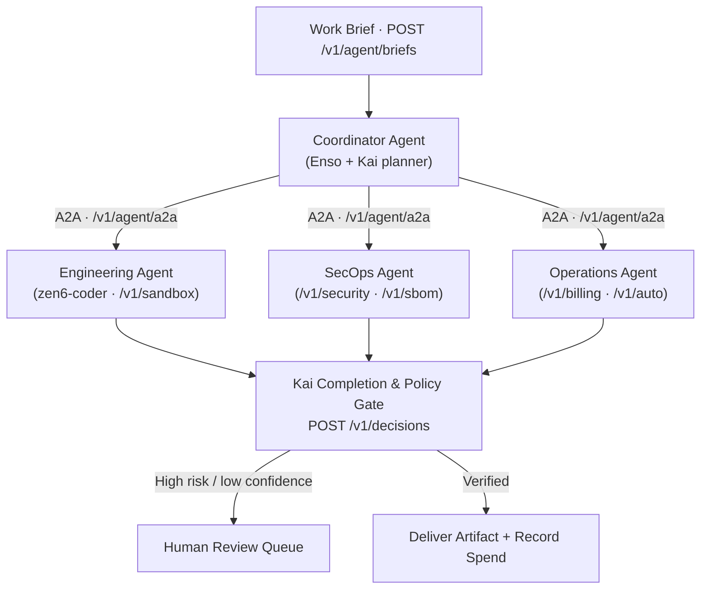

**A single generalist agent with root keys is an outage waiting to happen.** An autonomous organization decomposes work into narrow, role-scoped agents — each with its own model tier, tool allowlist, spend ledger, and escalation path.

## Workforce topology



## Create, run & audit an agent workforce

<Tabs items={['CLI', 'SDK', 'HTTP', 'MCP']}>
<Tab value="CLI">
```bash
# 1. Create a role-scoped agent
hanzo agent create --data '{
  "name": "triage-specialist",
  "model": "enso-pro",
  "instructions": "Triage incoming engineering issues, reproduce bugs in sandbox, and attach root-cause briefs."
}'

# 2. Run the agent asynchronously by name or id
hanzo agent run triage-specialist --data '{"input":"Investigate elevated 502 rate on webhook deliveries since 14:00 UTC"}'

# 3. Inspect run status, activity, and real-time spend
hanzo agent runs triage-specialist
hanzo agent spend triage-specialist
```
</Tab>
<Tab value="SDK">
<Tabs items={['TypeScript', 'Python']}>
<Tab value="TypeScript">
```ts
import { Configuration, AgentApi } from 'hanzoai';

const agents = new AgentApi(new Configuration({ accessToken: process.env.HANZO_API_KEY }));
await agents.postAgent({
  name: 'triage-specialist',
  model: 'enso-pro',
  instructions: 'Triage incoming engineering issues, reproduce bugs in sandbox, and attach root-cause briefs.',
});

const run = await agents.postAgentByRefRun('triage-specialist', {
  input: 'Investigate elevated 502 rate on webhook deliveries since 14:00 UTC',
});
const spend = await agents.getAgentByRefSpend('triage-specialist');
console.log({ run: run.data, spend: spend.data });
```
</Tab>
<Tab value="Python">
```python
import os
from hanzoai.cloud import ApiClient, Configuration
from hanzoai.cloud.api import AgentApi

api = AgentApi(ApiClient(Configuration(access_token=os.environ["HANZO_API_KEY"])))
api.post_agent({
    "name": "triage-specialist",
    "model": "enso-pro",
    "instructions": "Triage incoming engineering issues, reproduce bugs in sandbox, and attach root-cause briefs.",
})
run = api.post_agent_by_ref_run(
    "triage-specialist",
    {"input": "Investigate elevated 502 rate on webhook deliveries since 14:00 UTC"},
)
print(run, api.get_agent_by_ref_spend("triage-specialist"))
```
</Tab>
</Tabs>
</Tab>
<Tab value="HTTP">
```bash
curl -s -X POST https://api.hanzo.ai/v1/agent \
  -H "Authorization: Bearer $HANZO_API_KEY" \
  -H "Content-Type: application/json" \
  -d '{"name":"triage-specialist","model":"enso-pro","instructions":"Triage incoming engineering issues and attach root-cause briefs."}' | jq '.'

curl -s -X POST https://api.hanzo.ai/v1/agent/triage-specialist/run \
  -H "Authorization: Bearer $HANZO_API_KEY" \
  -H "Content-Type: application/json" \
  -d '{"input":"Investigate elevated 502 rate on webhook deliveries since 14:00 UTC"}' | jq '.'

curl -s https://api.hanzo.ai/v1/agent/triage-specialist/spend \
  -H "Authorization: Bearer $HANZO_API_KEY" | jq '.'
```
</Tab>
<Tab value="MCP">
```bash
curl -X POST https://api.hanzo.ai/v1/mcp \
  -H "Authorization: Bearer $HANZO_API_KEY" \
  -H "Content-Type: application/json" \
  -d '{
    "jsonrpc": "2.0",
    "id": 1,
    "method": "tools/call",
    "params": {
      "name": "agent",
      "arguments": {"op": "get_agent", "input": {}}
    }
  }'
```
</Tab>
</Tabs>

## Operating rules for production workforces

- **Budget every agent**: Query `GET /v1/agent/{ref}/spend` and configure billing alerts (`/v1/billing/alerts`) so runaway loops halt automatically.
- **Keep briefs structured**: Dispatch repeatable work through `POST /v1/agent/briefs` and replay via `POST /v1/agent/briefs/{id}/rerun`.
- **Separate builders from reviewers**: Never let the same agent both author a change and approve its own release.

## Related courses & docs

- [AUTO 301 — Autonomous Organizations](https://hanzo.university/autonomous-organizations) ([Interactive Lab](https://hanzo.app/learn/autonomous-organizations))
- [Build Your AI Company](/docs/business) · [Agent Flow Guide](/docs/guides/agent)
