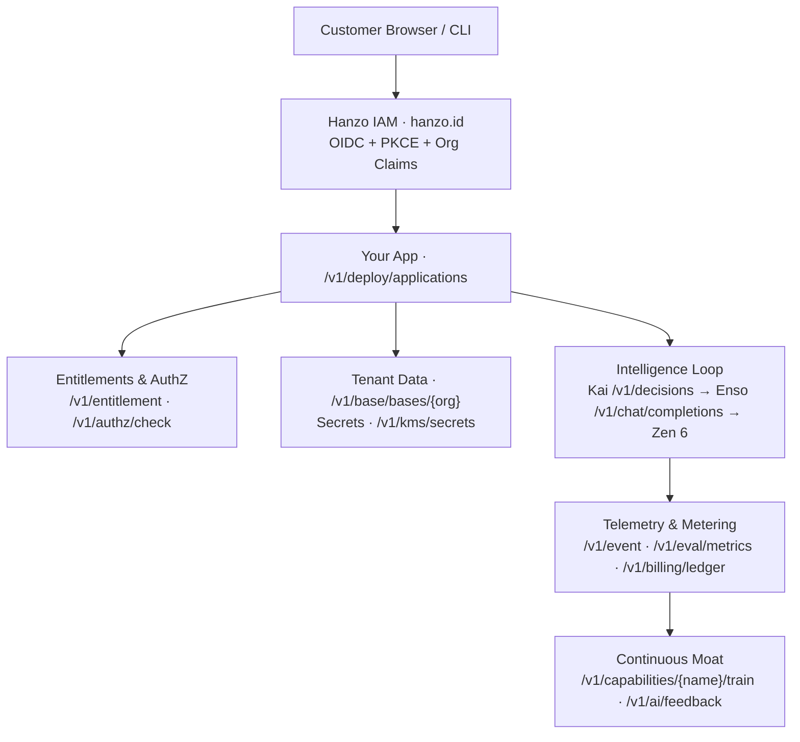

**One stack from first prototype to enterprise ARR.** This reference blueprint shows how every Hanzo capability snaps together to run a multi-tenant AI SaaS without stitching twelve disconnected SaaS vendors.



## Five-step launch sequence

<Steps>
<Step>
### 1. Authenticate & isolate tenants

Use Hanzo IAM (`hanzo.id`) for login, SSO, and org scoping. Never write bespoke password hashing or session stores. Resolve per-org plan features via `GET https://api.hanzo.ai/v1/entitlement/orgs/{org}`.
</Step>

<Step>
### 2. Store tenant state & secrets safely

Persist structured application data in Hanzo Base (`POST https://api.hanzo.ai/v1/base/graphql`) and keep external connector credentials strictly inside Hanzo KMS (`/v1/kms/secrets`).
</Step>

<Step>
### 3. Run the Kai + Enso + Zen intelligence loop

- Gate inputs, route intents, and verify policy via `POST https://api.hanzo.ai/v1/decisions` (`model: "kai"`).
- Route generative tasks via `POST https://api.hanzo.ai/v1/chat/completions` (`model: "enso-auto"`, bounded by `X-Max-Cost`).
- Use `zen6` or `zen6-flash` when you need deterministic open-weight pricing or local/sovereign execution.
</Step>

<Step>
### 4. Meter usage, events & quality

Record product and economic events via `POST https://api.hanzo.ai/v1/event`, monitor latency and token spend in `GET https://api.hanzo.ai/v1/eval/metrics`, and bill org usage from `GET https://api.hanzo.ai/v1/billing/usage`.
</Step>

<Step>
### 5. Deploy & roll back deterministically

Ship application builds through `/v1/deploy/applications` and roll back instantly on anomaly via `POST https://api.hanzo.ai/v1/deploy/applications/{name}/rollback`.
</Step>
</Steps>

## Verify your live stack in one shell check

```bash
# Verify auth, balance, deployed apps, and recent AI metrics
hanzo auth show
hanzo billing balance
hanzo deploy applications list
curl -s "https://api.hanzo.ai/v1/eval/metrics?range=24h" \
  -H "Authorization: Bearer $HANZO_API_KEY" | jq '.'
```

## Related courses & guides

- [ENT 401 — Build Your AI Company](https://hanzo.university/build-your-ai-company) ([Interactive Lab](https://hanzo.app/learn/build-your-ai-company))
- [ARC 105 — AI Architect](https://hanzo.university/ai-architect) ([Interactive Lab](https://hanzo.app/learn/ai-architect))
- [Business Practical Guides (4 recipes)](/docs/guides/business) · [Hanzo for Startups](/docs/startups)
