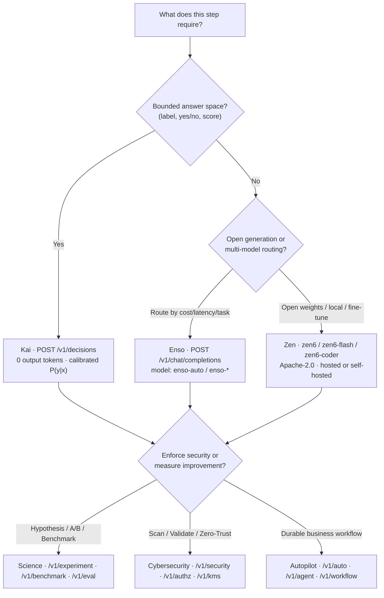

**Start with the shape of the problem, not the largest model.** Hanzo separates bounded judgment, adaptive routing, open-ended generation, empirical discovery, security enforcement, and durable operations into distinct primitives behind one `/v1/` contract.

## Architecture comparison matrix

| Primitive | Use when | Canonical endpoint | Output shape | Training / adaptation | Cost & latency profile | Status |
|---|---|---|---|---|---|---|
| **[Kai](/docs/decisions)** | Routing tickets, gating commands, classifying intents, scoring rubrics, detecting policy violations | `POST /v1/decisions` | Calibrated probability distribution (`choice`, `noul`, `score`), 0 output tokens | CPU capability training via [`POST /v1/capabilities/{name}/train`](/docs/training/kai-capabilities) | `$0.021` per 1M input tokens; `~38 ms` p50 single question on CPU | `shipped` |
| **[Enso](/docs/models/enso)** | Selecting the optimal model tier per prompt under cost/latency bounds with automatic failover | `POST /v1/chat/completions` (`model: "enso-auto"`) | OpenAI-compatible completion + `X-Routed-Model` / `X-Hanzo-Served` | Outcome rewards via `POST /v1/ai/feedback` and custom blends via `POST /v1/benchmark/presets` | `12 µs` learned router decision; bills the tier that answered (`enso-flash` to `enso-ultra`) | `shipped` |
| **[Zen](/docs/models/zen)** | Agentic coding, deep reasoning, multimodal analysis, brand-voice content, local/air-gapped inference | `POST /v1/chat/completions` (`model: "zen6"`) | Streaming text, tool calls, embeddings, vision, speech | LoRA / QLoRA / RL via [`POST /v1/train/jobs`](/docs/training/zen-fine-tuning) and `/v1/train/clients` | `$0.15` (`zen6-flash`) to `$0.60` (`zen6`) per 1M input tokens; Apache-2.0 weights | `shipped` |
| **[Science](/docs/science)** | Proving a prompt, model, or harness change actually improves outcomes without regressions | `POST /v1/experiment`, `GET /v1/benchmark/compare`, `POST /v1/eval/evaluators` | Paired McNemar p-values, confidence intervals, versioned evidence | Automated improvement studies and outcome-triggered research automations | Deterministic statistical evaluation; zero generative overhead in gates | `shipped` |
| **[Cybersecurity](/docs/cybersecurity)** | Threat modeling, secret scanning, SBOM auditing, sandboxed exploit validation, zero-trust enforcement | `POST /v1/security/scans`, `GET /v1/sbom/{ref}`, `POST /v1/authz/check` | Findings, risk scores, compliance coverage, deterministic `allow < ask < deny` | Custom Kai security capabilities and automated remediation playbooks | Sub-millisecond AuthZ checks; ephemeral microVM sandboxes | `shipped` |
| **[Autopilot](/docs/autopilot)** | Running continuous business workflows, multi-channel marketing, and budgeted agent workforces | `POST /v1/auto/automations`, `POST /v1/agent/{ref}/run`, `POST /v1/campaign` | Durable execution history, spend ledgers, review gates | Continuous memory extraction, Kai `agent.learn@1` outcome hooks, A/B optimization | Event-driven schedules; per-agent spend caps and human approval checkpoints | `shipped` |

## The canonical production loop

Most production Hanzo systems compose all six layers rather than choosing only one:

1. **Enso** receives the request and applies cost and latency bounds (`X-Max-Cost`, `X-Max-Latency-Ms`).
2. **Kai** resolves every bounded control question (intent, risk verdict, tool selection, completion check) with calibrated confidence and abstention thresholds.
3. **Policy + Cybersecurity** joins Kai's verdict with deterministic rules on `allow < ask < deny`, checks `POST /v1/authz/check`, and executes untrusted code inside `/v1/sandbox`.
4. **Zen** performs the open-ended work — writing code, drafting copy, synthesizing analysis — only when generation is genuinely needed.
5. **Science** records traces (`/v1/eval/traces`), evaluates changes against held-out rubrics (`/v1/eval/runs`), and runs paired comparisons (`GET /v1/benchmark/compare`).
6. **Training & Autopilot** turns production corrections into org-private Kai capabilities (`POST /v1/capabilities/{name}/train`), Enso reward updates (`POST /v1/ai/feedback`), or fine-tuned Zen adapters (`POST /v1/train/jobs`).

## Decision checklist

| Question | If yes, start here |
|---|---|
| Are you asking a generative LLM to output JSON enums or `true`/`false`? | Move that step to **[Kai](/docs/decisions)** and train domain rules with **[Kai Capabilities](/docs/training/kai-capabilities)**. |
| Are you hardcoding a single expensive frontier model for every prompt? | Switch to **[Enso](/docs/models/enso)** (`enso-auto`) and tune routing in **[Enso Routing Optimization](/docs/training/enso-routing)**. |
| Do you need open weights on your own GPUs or custom domain synthesis? | Deploy **[Zen 6](/docs/models/zen)** and specialize it with **[Zen Fine-Tuning](/docs/training/zen-fine-tuning)**. |
| Are prompt and model changes shipping on gut feel? | Gate releases with **[Science & Experiments](/docs/science/studies-experiments)** and **[Evaluation](/docs/training/evaluation)**. |
| Are agents touching shells, secrets, or production services? | Wrap tool execution in **[OpenCyber](/docs/cybersecurity/opencyber)** and **[Sovereign Zero-Trust](/docs/cybersecurity/sovereign-zero-trust)**. |
| Are you stitching cron jobs and fragile webhook glue around agents? | Move orchestration to **[Business Autopilot](/docs/autopilot/business)** and **[Agent Workforces](/docs/autopilot/workforces)**. |
| Are you packaging AI capabilities for paying external customers? | Build multi-tenant billing and white-label isolation in **[Build a Business](/docs/business)**. |

## Next steps & interactive labs

- **Read the deep dives**: [Training & Optimization](/docs/training) · [Science & Research](/docs/science) · [Cybersecurity](/docs/cybersecurity) · [Autopilot](/docs/autopilot) · [Build a Business](/docs/business) · [50 Practical Guides](/docs/guides)
- **Take the courses on Hanzo University**:
  - [AUTO 101 — Continuous Improvement](https://hanzo.university/continuous-improvement) ([Interactive Lab](https://hanzo.app/learn/continuous-improvement))
  - [PRA 104 — AI Practitioner](https://hanzo.university/ai-practitioner) ([Interactive Lab](https://hanzo.app/learn/ai-practitioner))
  - [ARC 105 — AI Architect](https://hanzo.university/ai-architect) ([Interactive Lab](https://hanzo.app/learn/ai-architect))
