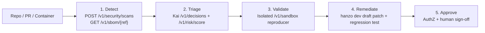

**OpenCyber is Hanzo's composable security architecture for defending code, containers, and autonomous agents continuously.** Instead of a monolithic black-box scanner that dumps unverified alerts, OpenCyber wires four narrow capabilities together:



## Run an OpenCyber detection & SBOM check

<Tabs items={['CLI', 'SDK', 'HTTP', 'MCP']}>
<Tab value="CLI">
```bash
# Inspect active secret-detection rule catalog
hanzo security rules

# Submit a batch of files for secret & credential scanning
hanzo security scans create --data '{
  "files": [
    {"path": "config/deploy.env", "content": "DATABASE_URL=postgres://app@db.internal/prod"}
  ]
}'

# Inspect findings across the org
hanzo security findings list
```
</Tab>
<Tab value="SDK">
<Tabs items={['TypeScript', 'Python']}>
<Tab value="TypeScript">
```ts
import { Configuration, SecurityApi } from 'hanzoai';

const sec = new SecurityApi(new Configuration({ accessToken: process.env.HANZO_API_KEY }));
const rules = await sec.getSecurityRules();
const scan = await sec.postSecurityScans({
  files: [{ path: 'config/deploy.env', content: 'DATABASE_URL=postgres://app@db.internal/prod' }],
});
console.log({ ruleCount: rules.data, scan: scan.data });
```
</Tab>
<Tab value="Python">
```python
import os
from hanzoai.cloud import ApiClient, Configuration
from hanzoai.cloud.api import SecurityApi

api = SecurityApi(ApiClient(Configuration(access_token=os.environ["HANZO_API_KEY"])))
print(api.get_security_rules())
print(api.post_security_scans({
    "files": [{"path": "config/deploy.env", "content": "DATABASE_URL=postgres://app@db.internal/prod"}]
}))
```
</Tab>
</Tabs>
</Tab>
<Tab value="HTTP">
```bash
# 1. List active secret-detection rules
curl -s https://api.hanzo.ai/v1/security/rules \
  -H "Authorization: Bearer $HANZO_API_KEY" | jq '.'

# 2. Scan candidate files
curl -s -X POST https://api.hanzo.ai/v1/security/scans \
  -H "Authorization: Bearer $HANZO_API_KEY" \
  -H "Content-Type: application/json" \
  -d '{"files":[{"path":"config/deploy.env","content":"DATABASE_URL=postgres://app@db.internal/prod"}]}' | jq '.'

# 3. Inspect container image SBOM by digest or tag
curl -s "https://api.hanzo.ai/v1/sbom/ghcr.io/hanzoai/cloud:latest" \
  -H "Authorization: Bearer $HANZO_API_KEY" | jq '.'
```
</Tab>
<Tab value="MCP">
```bash
curl -X POST https://api.hanzo.ai/v1/mcp \
  -H "Authorization: Bearer $HANZO_API_KEY" \
  -H "Content-Type: application/json" \
  -d '{
    "jsonrpc": "2.0",
    "id": 1,
    "method": "tools/call",
    "params": {
      "name": "security",
      "arguments": {"op": "get_security_findings", "input": {}}
    }
  }'
```
</Tab>
</Tabs>

## Separation of duties inside OpenCyber

- **Scanner identity** holds read-only access to repositories, digests, and `/v1/security/scans`.
- **Validator identity** runs strictly inside an ephemeral `/v1/sandbox` with no production secrets and no egress to internal networks.
- **Remediation identity** opens draft PRs only; merge and deployment stay under branch protection and human approval.

## Related courses & docs

- [CYB 201 — Agentic Cybersecurity](https://hanzo.university/agentic-cybersecurity) ([Interactive Lab](https://hanzo.app/learn/agentic-cybersecurity))
- [Security Assessments](/docs/cybersecurity/assessments) · [Vulnerability Validation](/docs/cybersecurity/vulnerability-validation)
