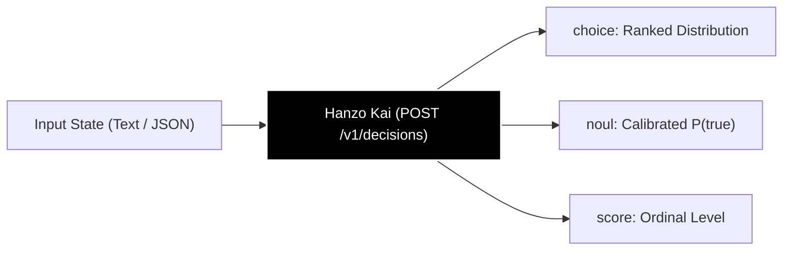
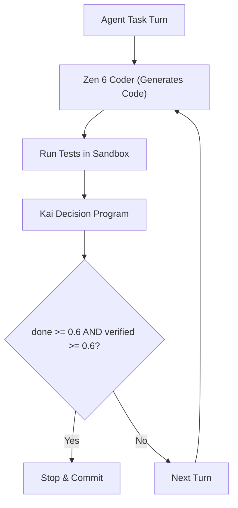

# How to Use Kai: Hanzo Decision Model Guide (and Jev Alternative)

If you are looking for a fast, low-cost, and deterministic alternative to generative LLMs—or searching for **TypeSafe Jev** on OpenRouter—**Hanzo Kai** is Hanzo's newest decision model. 

Unlike traditional autoregressive language models that generate unstructured text token by token, Kai evaluates a given state and returns **calibrated probability distributions** over bounded questions. Because Kai produces no conversational filler, **output tokens are always 0**, making decisions drastically faster, mathematically predictable, and up to 50% cheaper than Jev.

---

## What is Hanzo Kai?

**Hanzo Kai** is a purpose-built classification and decision model served at:

```http
POST https://api.hanzo.ai/v1/decisions
```

When building autonomous agents, support triage pipelines, or content moderation filters, software engineers frequently ask bounded questions:
- *Which department should handle this ticket?*
- *Is this user query a bug or a feature request?*
- *Has this agent task been verified by passing test output?*

Asking an autoregressive model (like GPT-4 or Claude) costs money for both prompt processing and text generation, plus additional latency and fragile JSON parsing logic. Kai solves this by scoring each candidate option directly against the input state with zero generated text.



---

## Kai vs. Jev: Why Developers are Migrating

If you have used **TypeSafe Jev** via the OpenRouter Decisions API (`typesafe/jev-1.13`), Kai implements the exact same wire format with significant cost and accuracy advantages:

| Feature / Metric | TypeSafe Jev (OpenRouter) | Hanzo Kai (`model: "kai"`) |
| :--- | :--- | :--- |
| **API Endpoint** | `openrouter.ai/api/alpha/decisions` | `api.hanzo.ai/v1/decisions` |
| **Input Price** | $0.042 per million tokens | **$0.021 per million tokens (50% savings)** |
| **Output Price** | Free | **Free (0 output tokens)** |
| **Accuracy (12 Benchmark Suites)** | Leads on 1 suite | **Leads on 11 of 12 suites (AG News, Banking77, spam)** |
| **Wire Protocol** | OpenRouter Decisions API | Identical OpenRouter Decisions specification |
| **Multi-Language Support** | Strong | Native 51-language multilingual encoder |
| **Telemetry & Routing** | Basic metadata | Monotonic latency, SHA-256 state hash, calibration hash |

> **Cost Example**: Running 100,000 classification calls with 500 input tokens each costs **$2.10 on Jev**, but only **$1.05 on Kai**.

---

## Getting Started: Making Your First Call to Kai

### 1. Prerequisites
You will need a Hanzo API key (`sk-...`). You can mint one in the [Hanzo Console](https://platform.hanzo.ai) or via the CLI:

```bash
# Install the Hanzo CLI
curl -fsSL https://hanzo.sh | sh

# Authenticate and set environment variable
hanzo auth login
export HANZO_API_KEY=sk-...
```

### 2. cURL Example
Send a customer support ticket to classify the user's intent, whether it is a defect, and its urgency level in a single request:

```bash
curl -X POST https://api.hanzo.ai/v1/decisions \
  -H "Authorization: Bearer $HANZO_API_KEY" \
  -H "Content-Type: application/json" \
  -d '{
    "model": "kai",
    "state": "I was double charged on my March subscription invoice and need a refund immediately.",
    "questions": {
      "is_bug": {
        "type": "noul",
        "instructions": "Is this a software defect?",
        "criteria": {"true": "a bug", "false": "billing inquiry or normal operation"}
      },
      "team": {
        "type": "choice",
        "instructions": "Which department should handle this request?",
        "criteria": {
          "billing": "charges, invoices, refunds, and subscriptions",
          "support": "account settings, login, and general help",
          "engineering": "product defects and API crashes"
        }
      },
      "urgency": {
        "type": "score",
        "instructions": "How urgent is this customer issue?",
        "criteria": ["low", "medium", "high", "critical"]
      }
    }
  }'
```

### 3. Response Structure
Kai returns the exact probabilities and the winning option under each question name:

```json
{
  "id": "dec_8f7b2c9e10a4b3d8",
  "model": "kai",
  "provider": "Hanzo",
  "answers": {
    "is_bug": {
      "type": "noul",
      "noul": 0.082,
      "answer_confidence": 0.918
    },
    "team": {
      "type": "choice",
      "choice": "billing",
      "confidence": 0.994,
      "probabilities": {
        "billing": 0.996,
        "support": 0.003,
        "engineering": 0.001
      },
      "answer_confidence": 0.996
    },
    "urgency": {
      "type": "score",
      "score": 2.74,
      "confidence": 0.82,
      "legend": {
        "0": "low",
        "1": "medium",
        "2": "high",
        "3": "critical"
      },
      "probabilities": {
        "0": 0.02,
        "1": 0.08,
        "2": 0.35,
        "3": 0.55
      },
      "answer_confidence": 0.55
    }
  },
  "usage": {
    "input_tokens": 142,
    "output_tokens": 0
  },
  "routing": {
    "backend": "kai",
    "checkpoint": "a7",
    "sha256": "0834a74f2d140642a453373da09e5a128e3d2c8d9e8bb1dcaf86d7210a4ecdfc"
  },
  "latency_ms": 112.4
}
```

---

## The Three Question Types Explained

Kai supports three distinct question types tailored to different decision shapes:

### 1. `choice` (Categorical Classification)
Use `choice` when picking one discrete label from a list. You provide a map of labels to human-readable descriptions in `criteria`:

```json
"team": {
  "type": "choice",
  "instructions": "Which department should handle this request?",
  "criteria": {
    "security": "phishing, credentials, vulnerability reports",
    "finance": "invoices, payments, taxes, chargebacks",
    "product": "feature requests, UI feedback, bug reports"
  }
}
```

* **Output**: `choice` indicates the highest-probability label. `probabilities` maps each candidate label to its probability (summing to 1.0).

### 2. `noul` (Binary Truth Assertion)
Use `noul` (named for "no / null / nil") to determine whether a proposition holds true. It evaluates boolean statements with symmetric calibration:

```json
"needs_human_escalation": {
  "type": "noul",
  "instructions": "Does this message contain abusive language or require human manager intervention?",
  "criteria": {
    "true": "abusive or escalated to manager",
    "false": "polite, standard conversation"
  }
}
```

* **Output**: `noul` is $P(\text{true})$. `answer_confidence` is $\max(p, 1 - p)$.

### 3. `score` (Ordinal Ranking)
Use `score` when evaluating an ordered scale (e.g. sentiment, urgency, quality rating). Provide levels in ascending order:

```json
"satisfaction": {
  "type": "score",
  "instructions": "What is the customer's sentiment level?",
  "criteria": ["very_negative", "negative", "neutral", "positive", "delighted"]
}
```

* **Output**: `score` is a continuous expected value along the scale. `probabilities` returns the distribution across the ordinal bins.

---

## Migrating from TypeSafe Jev to Hanzo Kai in 60 Seconds

Because Hanzo natively supports the OpenRouter Decisions specification, migrating from Jev requires changing only three configuration lines in your client:

```diff
- const BASE_URL = 'https://openrouter.ai/api/alpha';
+ const BASE_URL = 'https://api.hanzo.ai/v1';

- const API_KEY = process.env.OPENROUTER_API_KEY;
+ const API_KEY = process.env.HANZO_API_KEY;

- const MODEL = 'typesafe/jev-1.13';
+ const MODEL = 'kai';
```

### Python Migration Example

```python
import os
import requests

def get_decision(state: str, questions: dict) -> dict:
    url = "https://api.hanzo.ai/v1/decisions"
    headers = {
        "Authorization": f"Bearer {os.environ['HANZO_API_KEY']}",
        "Content-Type": "application/json"
    }
    payload = {
        "model": "kai",  # Formerly 'typesafe/jev-1.13'
        "state": state,
        "questions": questions
    }
    response = requests.post(url, headers=headers, json=payload)
    response.raise_for_status()
    return response.json()
```

---

## Production Patterns: When to Use Kai

### 1. Bounded Agentic Loops (Control Flow without Generative Drift)
In agentic workflows, asking a generative LLM *"Is the task finished?"* wastes money and introduces parsing bugs. Kai enables finite-state agent control:



Using Kai's `complete.json` schema:
```json
{
  "model": "kai",
  "questions": {
    "done": {"type": "noul", "instructions": "Has the agent completed all user requirements?"},
    "verified": {"type": "noul", "instructions": "Is the result verified by passing test output?"}
  }
}
```

Only when both $P(\text{done}) \ge 0.6$ and $P(\text{verified}) \ge 0.6$ does the loop stop.

### 2. High-Throughput Request Routing (Enso + Kai)
Combine Kai with **Enso** to classify incoming webhooks, emails, or user prompts and dispatch them to the optimal model tier:
- Cheap formatting $\rightarrow$ `enso-flash`
- Complex coding $\rightarrow$ `zen6`
- Ambiguous multi-step planning $\rightarrow$ `enso-ultra`

---

## Technical Specifications & Best Practices

- **Context Window**: Kai processes up to **1,024 input tokens per question**. For long documents, place the decision-critical context first or split large documents into targeted chunks.
- **Option Count**: Kai evaluates options independently via its multilingual encoder. Listing options in a different order produces the exact same probabilities.
- **Latency**: In-model execution takes **~50–100 ms on CPU** for single questions.
- **Reliability & Errors**: Unlike generative models that fail with malformed syntax, Kai always guarantees valid typed responses conforming to its schema.

---

## Related Documentation & Next Steps

- [Decisions API Reference](/docs/decisions) — Complete specification of `POST /v1/decisions`.
- [Kai Model Card & Benchmarks](/docs/models/kai) — Checkpoint evaluations across 12 suites.
- [Enso Learned Routing](/docs/models/enso) — How Enso routes requests across model families.
- [Jev Migration Guide](/docs/guides/migrate/jev) — Step-by-step wire diff between Jev and Kai.
- [Pricing & Credits](/docs/pricing) — Detailed breakdown of token and tool billing.
