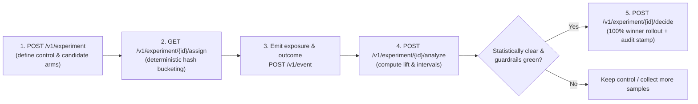

**Offline evals catch regressions before launch; controlled experiments prove impact on real traffic.** Hanzo separates variant assignment (pure deterministic read), statistical analysis (non-mutating), and rollout decision (audited production mutation) into explicit endpoints on `/v1/experiment`.

## Controlled experiment lifecycle



## Run an A/B experiment across all four surfaces

<Tabs items={['CLI', 'SDK', 'HTTP', 'MCP']}>
<Tab value="CLI">
```bash
# 1. Create experiment
hanzo experiment create --data '{
  "name": "enso-pro-vs-zen6-coder",
  "hypothesis": "zen6-coder matches PR acceptance at lower unit cost",
  "variants": [{"key": "control", "weight": 50}, {"key": "zen6_coder", "weight": 50}]
}'

# 2. Deterministic subject assignment (pure read; emit exposure via /v1/event)
hanzo experiment assign "$EXP_ID" --subject "user_42"

# 3. Analyze measured variant outcomes
hanzo experiment analyze "$EXP_ID"

# 4. Promote winner to 100% rollout once evidence clears threshold
hanzo experiment decide "$EXP_ID" --data '{"winner": "zen6_coder"}'
```
</Tab>
<Tab value="SDK">
<Tabs items={['TypeScript', 'Python']}>
<Tab value="TypeScript">
```ts
import { Configuration, ExperimentApi } from 'hanzoai';

const exp = new ExperimentApi(new Configuration({ accessToken: process.env.HANZO_API_KEY }));
const { data: created } = await exp.postExperiment({
  name: 'enso-pro-vs-zen6-coder',
  variants: [
    { key: 'control', weight: 50 },
    { key: 'zen6_coder', weight: 50 },
  ],
});

const { data: arm } = await exp.getExperimentByIdAssign(created.id, 'user_42');
const { data: analysis } = await exp.postExperimentByIdAnalyze(created.id);
console.log({ arm, analysis });
```
</Tab>
<Tab value="Python">
```python
import os
from hanzoai.cloud import ApiClient, Configuration
from hanzoai.cloud.api import ExperimentApi

api = ExperimentApi(ApiClient(Configuration(access_token=os.environ["HANZO_API_KEY"])))
created = api.post_experiment({
    "name": "enso-pro-vs-zen6-coder",
    "variants": [{"key": "control", "weight": 50}, {"key": "zen6_coder", "weight": 50}],
})
arm = api.get_experiment_by_id_assign(created["id"], subject="user_42")
analysis = api.post_experiment_by_id_analyze(created["id"])
print(arm, analysis)
```
</Tab>
</Tabs>
</Tab>
<Tab value="HTTP">
```bash
EXP_ID=$(curl -s -X POST https://api.hanzo.ai/v1/experiment \
  -H "Authorization: Bearer $HANZO_API_KEY" \
  -H "Content-Type: application/json" \
  -d '{"name":"enso-pro-vs-zen6-coder","variants":[{"key":"control","weight":50},{"key":"zen6_coder","weight":50}]}' | jq -r '.id')

curl -s "https://api.hanzo.ai/v1/experiment/${EXP_ID}/assign?subject=user_42" \
  -H "Authorization: Bearer $HANZO_API_KEY" | jq '.'

curl -s -X POST "https://api.hanzo.ai/v1/experiment/${EXP_ID}/analyze" \
  -H "Authorization: Bearer $HANZO_API_KEY" | jq '.'

curl -s -X POST "https://api.hanzo.ai/v1/experiment/${EXP_ID}/decide" \
  -H "Authorization: Bearer $HANZO_API_KEY" \
  -H "Content-Type: application/json" \
  -d '{"winner":"zen6_coder"}' | jq '.'
```
</Tab>
<Tab value="MCP">
```bash
curl -X POST https://api.hanzo.ai/v1/mcp \
  -H "Authorization: Bearer $HANZO_API_KEY" \
  -H "Content-Type: application/json" \
  -d '{
    "jsonrpc": "2.0",
    "id": 1,
    "method": "tools/call",
    "params": {
      "name": "experiment",
      "arguments": {"op": "get_experiment", "input": {}}
    }
  }'
```
</Tab>
</Tabs>

<Callout type="info">
`GET /v1/experiment/{id}/assign` is intentionally a pure read: it hashes `subject` deterministically and records nothing. Always emit an exposure event (`POST /v1/event`) only when the subject actually renders or executes the assigned arm to avoid dilution bias.
</Callout>

## Improvement studies (`preview`)

For offline benchmark and harness studies, **Customize → Learning → Research** (and the alpha `POST /v1/research/studies` / `GET /v1/research/actions` surface documented in [Self-improvement](/docs/self-improvement)) evaluates incoming candidate runs against a pinned baseline run and emits `improved`, `regressed`, `inconclusive`, or `blocked` draft findings automatically.

## Related courses & docs

- [SCI 201 — Autonomous Research](https://hanzo.university/autonomous-research) ([Interactive Lab](https://hanzo.app/learn/autonomous-research))
- [Research Autopilot](/docs/science/research-autopilot) · [Benchmarking Arena](/docs/science/benchmarking)
