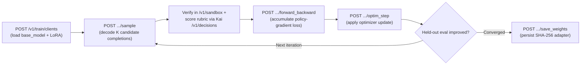

**Supervised fine-tuning teaches format; reinforcement learning teaches verifiable outcomes.** Hanzo exposes low-level, interactive gradient primitives at `/v1/train/clients` so your own Python or Rust trainer can orchestrate **DPO**, **PPO**, or **GRPO** loops without managing multi-GPU sharding or engine memory by hand.

## The interactive RL loop



## Five primitives on `/v1/train/clients`

| Endpoint | Role |
|---|---|
| `POST /v1/train/clients` | Load `base_model` onto the training engine with a fresh LoRA adapter and return `client_id` |
| `POST /v1/train/clients/{id}/sample` | Decode candidate completions directly from the live adapter weights |
| `POST /v1/train/clients/{id}/forward_backward` | Compute and accumulate gradients for a scored batch |
| `POST /v1/train/clients/{id}/optim_step` | Apply one optimizer step to accumulated gradients and clear buffers |
| `POST /v1/train/clients/{id}/save_weights` | Persist the adapter checkpoint to the org's artifact store |
| `DELETE /v1/train/clients/{id}` | Release engine GPU memory when the session completes |

## Minimal GRPO step across all four surfaces

<Tabs items={['CLI', 'SDK', 'HTTP', 'MCP']}>
<Tab value="CLI">
```bash
# 1. Create interactive training client
hanzo train clients create --data '{"base_model":"zen6-flash","lora_rank":16}'

# 2. Sample candidates from live weights
hanzo train clients sample "$CLIENT_ID" --data '{"prompts":["Write a constant-time HMAC compare in Go."],"n":4}'

# 3. After scoring candidates in sandbox/Kai, accumulate gradients & step
hanzo train clients forward_backward "$CLIENT_ID" --data @grpo_batch.json
hanzo train clients optim_step "$CLIENT_ID" --data '{"learning_rate":1e-5}'

# 4. Save checkpoint and inspect loss history
hanzo train clients save_weights "$CLIENT_ID" --data '{"name":"zen6-flash-grpo-step-100"}'
hanzo train clients get "$CLIENT_ID"
```
</Tab>
<Tab value="SDK">
<Tabs items={['TypeScript', 'Python']}>
<Tab value="TypeScript">
```ts
import { Configuration, TrainApi } from 'hanzoai';

const train = new TrainApi(new Configuration({ accessToken: process.env.HANZO_API_KEY }));

const { data: client } = await train.postTrainClients({
  base_model: 'zen6-flash',
  lora_rank: 16,
});
const id = client.id;

const { data: samples } = await train.postTrainClientsByIdSample(id, {
  prompts: ['Write a constant-time HMAC compare in Go.'],
  n: 4,
});
// Score samples with unit tests + Kai, build advantage-weighted batch:
await train.postTrainClientsByIdForwardBackward(id, { batch: samples });
await train.postTrainClientsByIdOptimStep(id, { learning_rate: 1e-5 });
await train.postTrainClientsByIdSaveWeights(id, { name: 'zen6-flash-grpo-step-100' });
```
</Tab>
<Tab value="Python">
```python
import os
from hanzoai.cloud import ApiClient, Configuration
from hanzoai.cloud.api import TrainApi

api = TrainApi(ApiClient(Configuration(access_token=os.environ["HANZO_API_KEY"])))
client = api.post_train_clients({"base_model": "zen6-flash", "lora_rank": 16})
cid = client["id"]

samples = api.post_train_clients_by_id_sample(
    cid, {"prompts": ["Write a constant-time HMAC compare in Go."], "n": 4}
)
# Compute group-relative advantages from unit-test pass/fail + Kai rubric scores
api.post_train_clients_by_id_forward_backward(cid, {"batch": samples})
api.post_train_clients_by_id_optim_step(cid, {"learning_rate": 1e-5})
api.post_train_clients_by_id_save_weights(cid, {"name": "zen6-flash-grpo-step-100"})
```
</Tab>
</Tabs>
</Tab>
<Tab value="HTTP">
```bash
# 1. Allocate live LoRA client
CLIENT_ID=$(curl -s -X POST https://api.hanzo.ai/v1/train/clients \
  -H "Authorization: Bearer $HANZO_API_KEY" \
  -H "Content-Type: application/json" \
  -d '{"base_model":"zen6-flash","lora_rank":16}' | jq -r '.id')

# 2. Sample K completions
curl -s -X POST "https://api.hanzo.ai/v1/train/clients/${CLIENT_ID}/sample" \
  -H "Authorization: Bearer $HANZO_API_KEY" \
  -H "Content-Type: application/json" \
  -d '{"prompts":["Write a constant-time HMAC compare in Go."],"n":4}'

# 3. Accumulate gradients & step optimizer
curl -s -X POST "https://api.hanzo.ai/v1/train/clients/${CLIENT_ID}/forward_backward" \
  -H "Authorization: Bearer $HANZO_API_KEY" \
  -H "Content-Type: application/json" \
  -d @grpo_batch.json

curl -s -X POST "https://api.hanzo.ai/v1/train/clients/${CLIENT_ID}/optim_step" \
  -H "Authorization: Bearer $HANZO_API_KEY" \
  -H "Content-Type: application/json" \
  -d '{"learning_rate":1e-5}'

# 4. Save adapter checkpoint & free client memory
curl -s -X POST "https://api.hanzo.ai/v1/train/clients/${CLIENT_ID}/save_weights" \
  -H "Authorization: Bearer $HANZO_API_KEY" \
  -H "Content-Type: application/json" \
  -d '{"name":"zen6-flash-grpo-step-100"}'

curl -s -X DELETE "https://api.hanzo.ai/v1/train/clients/${CLIENT_ID}" \
  -H "Authorization: Bearer $HANZO_API_KEY"
```
</Tab>
<Tab value="MCP">
```bash
curl -X POST https://api.hanzo.ai/v1/mcp \
  -H "Authorization: Bearer $HANZO_API_KEY" \
  -H "Content-Type: application/json" \
  -d '{
    "jsonrpc": "2.0",
    "id": 1,
    "method": "tools/call",
    "params": {
      "name": "train",
      "arguments": {"op": "get_train_clients", "input": {}}
    }
  }'
```
</Tab>
</Tabs>

## Verifiable rewards: Sandbox + Kai

Avoid reward hacking by grounding rewards in two layers:

1. **Deterministic verifier (`0` or `1`)**: Compile code, run unit tests, check SQL query results, or validate JSON schemas inside an isolated `/v1/sandbox`.
2. **Calibrated Kai rubric (`score` / `noul`)**: For style, conciseness, and safety dimensions where unit tests do not apply, score candidates via `POST /v1/decisions` (`usage.output_tokens == 0`, deterministic per weights + calibration hash).

Always release GPU memory with `DELETE /v1/train/clients/{id}` inside a `finally` block so crashed trainer processes never idle billed GPUs.

## Related courses & guides

- [RL 101 — Reinforcement Learning](https://hanzo.university/reinforcement-learning) ([Interactive Lab](https://hanzo.app/learn/reinforcement-learning))
- [ML 401 — ML Systems](https://hanzo.university/ml-systems) ([Interactive Lab](https://hanzo.app/learn/ml-systems))
- [Evaluation Harnesses](/docs/training/evaluation) · [Model Registry](/docs/training/model-registry)
